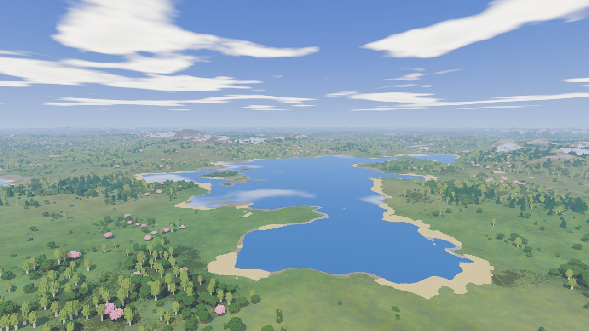
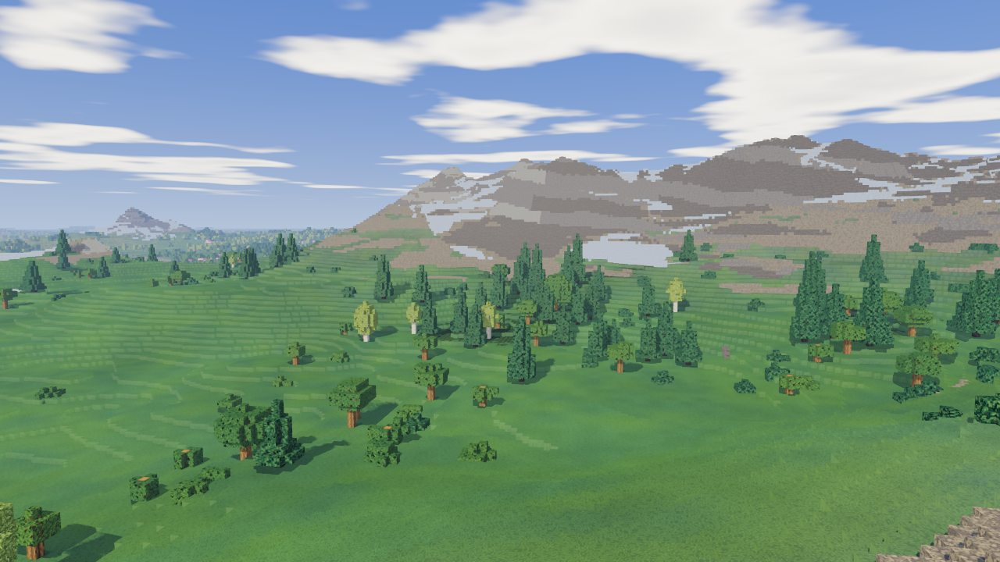
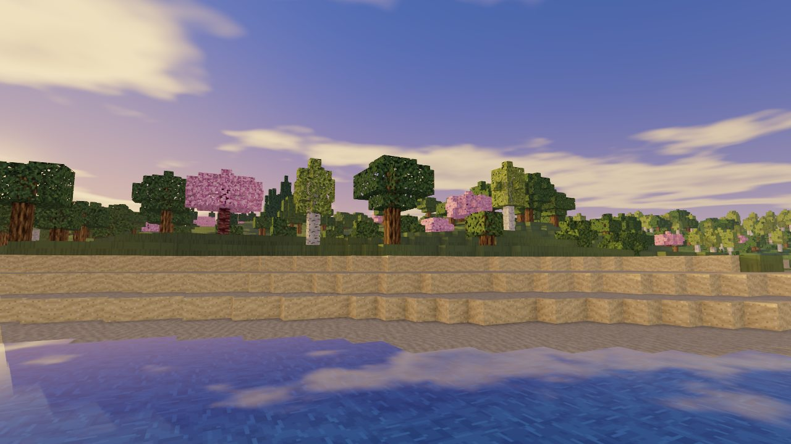
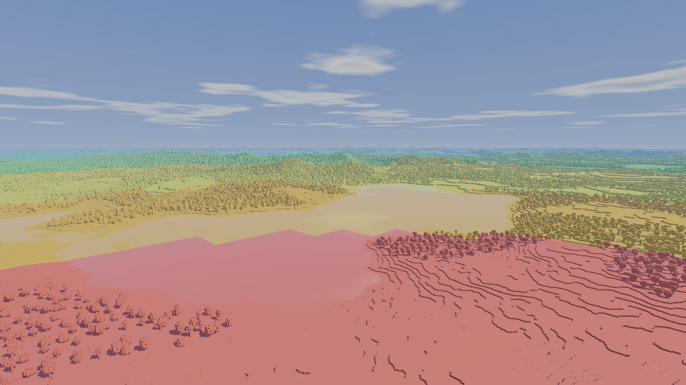
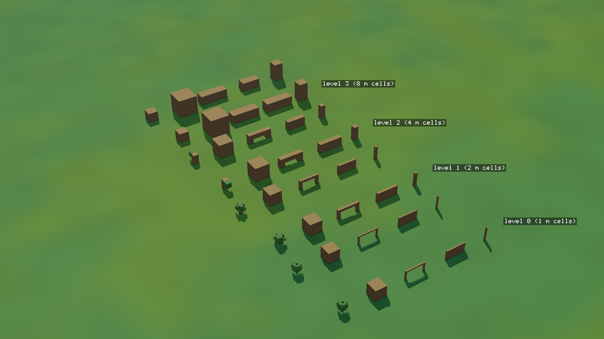
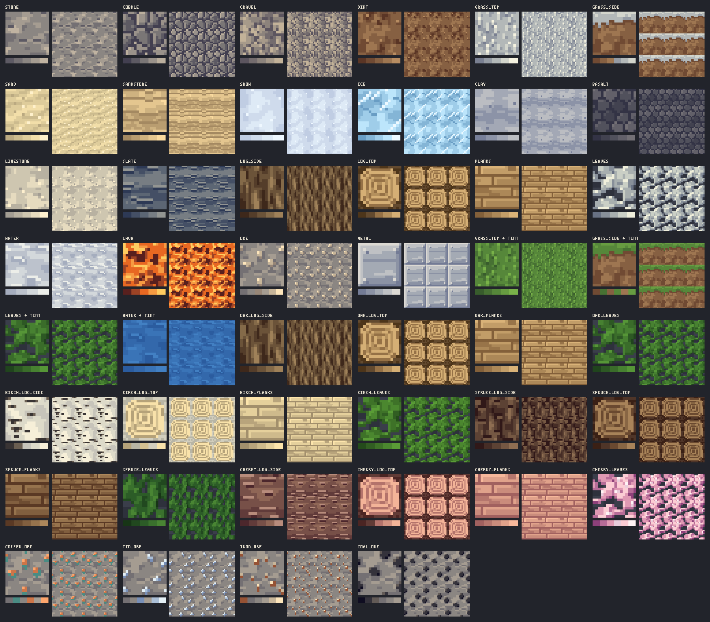

# Cubeplanet

Ein Aufbau- und Automatisierungsspiel auf würfelförmigen Planeten: von der Steinzeit bis zu Fabriken,
die über ein ganzes Sonnensystem laufen. Dieses Repository enthält die Engine, die gerade dafür
entsteht. Sie ist in Rust geschrieben und zeichnet über wgpu (Vulkan, DirectX 12 als Rückfallebene).



| | |
|---|---|
|  |  |
| Berge mit Graten, Rinnen und schrägen Gesteinsschichten | Abendlicht am Ufer |

Alle Bilder sind Echtzeit-Aufnahmen aus der Engine. Jeder Block ist 1 m groß; in der Ferne werden
die Zellen Stufe für Stufe gröber, damit auch Landschaften bis zum Horizont flüssig laufen.

## Stand

| Meilenstein | Inhalt | Stand |
|---|---|---|
| E0 | Fundament: Kern, Aufgabensystem, prozedurale Texturen, Inhalte, GPU-Bericht | fertig |
| E1 | Voxel-Kern: Chunks, Detail-Pyramide, Greedy-Mesher, Testwelten | gebaut, in der Abnahme |
| E2 | Renderer: GPU-getriebenes Zeichnen, G-Buffer, TAA, Debug-Ansichten | gebaut, in der Abnahme |
| E3 | Nachladen und Detailstufen: Flug vom Block bis in den Orbit | Entwurf in `engine/docs/STREAMING.md` |
| E4–E9 | Universum, Licht und Atmosphäre, Terrain, Wasser, Simulation, Wetter | geplant |

## Wie es funktioniert

| | |
|---|---|
|  |  |
| Detailstufen: Rot sind 1-m-Blöcke, jede weitere Farbe hat doppelt so große Zellen | Gebautes bleibt auch auf groben Stufen sichtbar |

- Die Welt liegt in Chunks aus 32 × 32 × 32 Zellen. Gespeichert werden nur Änderungen, das Gelände
  rechnet der Generator jederzeit gleich wieder aus.
- Ein Greedy-Mesher legt gleiche Flächen mit Bitmasken zu großen Rechtecken zusammen. Jedes Rechteck
  passt in 8 Byte.
- Die Grafikkarte entscheidet selbst, was sichtbar ist, und zeichnet alles mit zwei Befehlen.
- Positionen werden in 64 Bit gespeichert und relativ zur Kamera gezeichnet: Eine Szene 3.072 km
  vom Ursprung entfernt ergibt dasselbe Bild wie am Ursprung.
- Alle Texturen werden aus Regeln berechnet, nicht gemalt.



## Aufbau

- `engine/`: Cargo-Workspace mit den Crates `cp-*` und dem Programm `cpe`
- `engine/docs/`: Architektur (`ARCHITEKTUR.md`), Physik (`PHYSIK.md`), Nachladen (`STREAMING.md`),
  Messwerte und Bilder
- `docs/SPIELPLAN.md`: Spielkonzept, Zeitalter, Sonnensystem, Fahrplan
- `docs/PHYSIK-Zusammenfassung.md`: die Physik in Kurzform

## Starten

Voraussetzungen: Rust 1.99 oder neuer und eine Grafikkarte mit Vulkan oder DirectX 12.

```
cd engine
cargo run -p cp-app --release -- run --scene hills
```

Maus und WASD fliegen, Leertaste hoch, C runter, Shift schneller. F1 zeigt die Bildzeiten, F2
schaltet die Debug-Ansichten, F4 springt zwischen Kamerapunkten, F5 fliegt eine feste Route. Ein
Klick fängt die Maus, Esc gibt sie frei, zweimal Esc beendet.

Weitere Befehle: `cpe caps` (Fähigkeiten der Grafikkarte), `cpe shot` (Bild ohne Fenster),
`cpe bench` (Messung). Alle Prüfungen: `./check.ps1` in `engine/`.
